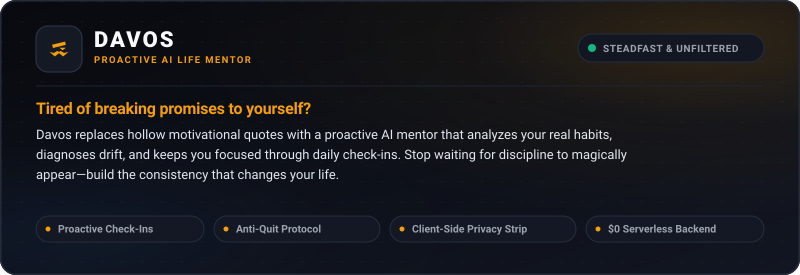
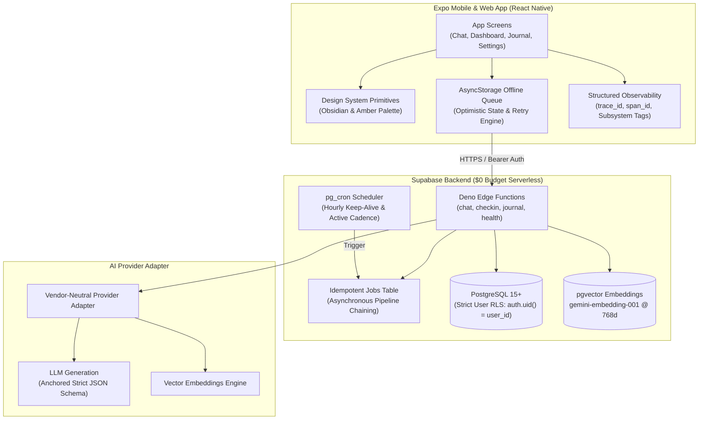

[](https://github.com/DhanushSaiNV/DavosSeaworth)
<br />

[](https://expo.dev/)&nbsp;
[](https://reactnative.dev/)&nbsp;
[](https://www.typescriptlang.org/)&nbsp;
[](https://supabase.com/)&nbsp;
[](https://www.postgresql.org/)&nbsp;
[](https://github.com/pgvector/pgvector)&nbsp;
[](https://deno.land/)&nbsp;
[](https://jestjs.io/)&nbsp;
[](https://eslint.org/)&nbsp;
[](https://expo.dev/)&nbsp;
[](./LICENSE)

---

## About Davos

> *"I was never a lord. I was a smuggler. The common sense of it was all I ever had to offer."*  
> — **Davos Seaworth**

Most productivity apps fail because they rely on hollow motivational cheerleading, passive journaling, and unsustainable willpower spikes. When real life hits, users experience cognitive drift, skip a day, feel guilt, and abandon the system entirely.

**Davos** is a chat-first, proactive AI life mentor engineered for unwavering consistency. Named after Ser Davos Seaworth—the loyal, unpretentious Onion Knight who gave his king the honest truth rather than flattering words—Davos serves as a steadfast anchor in the dark. It diagnoses behavioral drift before abandonment occurs, checks in during your active focus windows, and helps you execute your core commitments.

### The Zero-Dollar Engineering Reality
Davos is built under a strict **$0 infrastructure budget** sized for a 5-user capacity foundation. There are no paid third-party orchestrators, no external vector databases, and no ongoing server costs. The entire compute stack executes serverlessly within **Supabase Free Tier** (Deno Edge Functions, pgvector, pg_cron, and an idempotent transactional jobs queue) paired with **Expo Router** across iOS, Android, and Web.

---

## Key Features

### 🕒 Proactive Cadence & Hourly Check-Ins
- **Adaptive Windows**: Scheduled check-ins fire strictly during user-configured active focus hours (e.g., `09:00–18:00`) with tunable intervals (1h, 2h, or 3h).
- **Tactile Energy Latch**: Single-tap energy state recording (`😴 Exhausted`, `⚡ Peak Focus`, `🌱 Steady`) with immediate haptic latching and optimistic state sync.
- **Context-Aware Responses**: Mentoring replies dynamically adjust their tone and tactical depth based on your reported cognitive energy.

### 🧠 Long-Term Chat Memory & Late-Flag Purge
- **Boundary-Triggered Extraction**: As conversations progress, window crossings (every 8 messages) enqueue background extraction into durable, provenance-tagged facts.
- **Cognitive Recall in Stage 3**: Turn embeddings run parallel cosine similarity searches via `match_facts` RPC against indexed memory, feeding relevant context to generation without extra model roundtrips.
- **Late-Flag Memory Purge**: Long-press any personal chat bubble and select "Mark Unsavable" to immediately purge derived memory facts via `purge_memory` with zero trace left in the recalled corpus.

### 🎯 Anchor Planning & Just-In-Time (JIT) Interventions
- **Anchor Habits Ledger**: Locks down foundational routines (morning activation, deep work blocks, evening decompression).
- **Proactive Drift Interventions**: Davos actively intervenes when scheduled milestones pass without execution, diagnosing root-cause obstacles instead of nagging.

### 🛡️ The Anti-Quit Protocol & The Strike
- **Cognitive Triage**: Distinguishes between acute exhaustion (S1) and chronic avoidance/drift (S2).
- **The Strike Reset**: When cognitive overwhelm strikes, Davos automatically downsizes your plan to micro-commitments, preserving the habit chain and preventing complete abandonment.

### 🔒 Client-Side Privacy Strip ("Unsavable" Journal)
- **Local Text Purge**: Freeform evening unburdening journal includes an untouchable client-side filter.
- **Zero Leak Guarantee**: Text flagged with `[UNSAVABLE]` is surgically removed in memory **client-side before network transmission**. Flagged thoughts never reach Supabase, never hit Postgres logs, and are never sent to external LLMs.

### 📊 Proof-Based Telemetry
- **Grounded in Doings**: Replaces subjective self-assessment with verifiable habit completion ledgers.
- **RAG Over Habits**: Retrieval-Augmented Generation indexes your historical "doings" using `gemini-embedding-001@768` vectors to detect multi-week behavioral trends.

### ⚡ Offline-First Send Queue
- **Uninterrupted Flow**: Send messages, complete check-ins, or log reflections even with zero network connectivity.
- **Resilient Background Sync**: Queued operations persist in local storage and auto-replay with exponential backoff upon reconnection.

### 🔍 First-Class Client Observability
- **Zero Raw Console Logging**: Strict repository rule enforcing structured JSON telemetry (`logger.info`, `logger.warn`, `logger.error`) with subsystem tags (`chat`, `checkin`, `auth`, `net`, `dev`).
- **Distributed Trace Correlation**: Automatic injection of `trace_id` and `span_id` across network calls and Edge Functions.
- **Diagnostics Modal**: Built-in developer inspection modal (accessible via physical shake or settings) displaying recent structured logs, network waterfalls, and one-tap log export.

---

## System Architecture



### Core Architecture Decisions (ADR Summary)

| Decision | Specification | Architectural Rationale |
|:---|:---|:---|
| **D1: Platform Scope** | Universal Expo Router | Co-equal support for iOS, Android, and Web using standard React Native primitives. |
| **D2: Compute Architecture** | 100% Inside Supabase | Edge Functions (Deno), pg_cron, and jobs table satisfy all compute without external servers. |
| **D5: Vector Identity** | `gemini-embedding-001@768` | Fixed embedding model and dimensionality; frozen to prevent silent distance skew. |
| **D8: Persona Adaptation** | Adaptive Statistical Weighting | Persona shifts are computed via deterministic statistical weights (`persona_stats`), avoiding costly ML pipelines. |
| **D12: Chained Handlers** | Micro-Job Chaining | Decomposes long tasks into chained sub-jobs to strictly respect the serverless execution limit. |
| **D16 / D21: Severity Gate** | S1 / S2 Lockdown Exit | Acute crises bypass normal coaching and immediately route to high-empathy safety protocols. |

---

## Design System: Obsidian & Lantern Amber

Davos features a custom, accessible design system designed from first principles:

- **Obsidian Dark Foundation**: Deep background `#090A0F`, elevated surfaces `#12151E`, and clean borders `#262B3A`.
- **Steadfast Lantern Amber**: Primary action accent `#F59E0B` providing high contrast (7.4:1 dark, 6.2:1 light) against dark surfaces, meeting WCAG AA standards.
- **Strict 8dp Spatial Grid**: Predictable geometric spacing across all components (4, 8, 12, 16, 24, 32, 48, 64).
- **Tactile Micro-Interactions**: Custom haptic feedback profiles on interactive controls, with 100% `ReduceMotion` accessibility support.
- **Tabular Figures**: Clocks, countdowns, and habit counters enforce `tabular-nums` typography to prevent visual jitter.

---

## Tech Stack

| Layer | Technologies |
|:---|:---|
| **Frontend Framework** | [React Native 0.86](https://reactnative.dev/) & [Expo SDK 57](https://expo.dev/) (Expo Router v57) |
| **Language** | [TypeScript 6.0](https://www.typescriptlang.org/) (Strict Mode) |
| **Backend & Database** | [Supabase](https://supabase.com/) ([PostgreSQL](https://www.postgresql.org/), [pgvector](https://github.com/pgvector/pgvector), [Deno Edge Functions](https://deno.land/)) |
| **Vector Search** | `pgvector` 768-dimensional cosine distance indexing |
| **Testing Engine** | [Jest](https://jestjs.io/) & [jest-expo](https://github.com/expo/expo/tree/main/packages/jest-expo) (35 test suites, 623 passing tests) |
| **Quality & Linting** | [ESLint 9](https://eslint.org/), [Prettier 3](https://prettier.io/) |
| **Client Storage** | `@react-native-async-storage/async-storage` & `expo-secure-store` |
| **Haptics & Device** | `expo-haptics`, `expo-notifications`, `expo-crypto`, `react-native-safe-area-context` |

---

## Directory Structure

```text
DavosSeaworth/
├── app/                       # Expo Router route definitions
│   ├── (app)/                 # Authenticated application tabs
│   │   ├── _layout.tsx        # Tab bar navigation container
│   │   ├── chat.tsx           # Proactive coaching & message feed
│   │   ├── dashboard.tsx      # Telemetry, habit streaks & active cadence
│   │   ├── journal.tsx        # Evening reflection with privacy filter
│   │   └── settings.tsx       # Focus hours, cadence tuning & dev tools
│   ├── (onboarding)/          # Conversational intake & orientation
│   ├── auth/                  # OAuth & deep link coordinators
│   ├── sign-in.tsx            # Email OTP & Google OAuth flow
│   ├── verify-code.tsx        # 6-digit verification code screen
│   └── _layout.tsx            # Root layout & providers
├── assets/                    # Visual identity, SVG banners & branding
├── components/                # Modular UI primitives & modals
│   ├── ui/                    # Design system components (Button, Input, Card, Text)
│   ├── DiagnosticsModal.tsx   # In-app structured log viewer & network waterfall
│   └── OfflineBanner.tsx      # Connectivity status banner
├── lib/                       # Core client business logic & utilities
│   ├── logger.ts              # Structured JSON logging engine (zero raw console.*)
│   ├── observability.ts       # Network tracing & performance instrumentation
│   ├── chat.ts                # Optimistic messaging & state orchestration
│   ├── memoryFlag.ts          # Pure state machine & truth predicates for chat flagging
│   ├── checkins.ts            # Check-in intervals, energy parsing & scheduling
│   ├── sendQueue.ts           # Offline resilient transaction queue
│   └── journal/strip.ts       # Client-side [UNSAVABLE] privacy filter
├── supabase/                  # Supabase database & backend definitions
│   ├── functions/             # Deno Edge Functions (chat, checkin, journal, health)
│   └── migrations/            # Version-controlled PostgreSQL migrations & RLS policies
├── theme/                     # Foundation design tokens (colors, spacing, typography)
└── docs/                      # Authoritative specifications, PRDs & architecture decisions
```

---

## Getting Started

### Prerequisites
- **Node.js**: `v20.x` or higher
- **Package Manager**: `npm` or `pnpm`
- **Expo Go** or an iOS / Android simulator / development build
- **Supabase CLI** (optional, for local Edge Function testing)

### 1. Clone & Install
```bash
# Clone the repository
git clone https://github.com/DhanushSaiNV/DavosSeaworth.git
cd DavosSeaworth

# Install dependencies
npm install
```

### 2. Environment Configuration
Copy the template environment file:
```bash
cp .env.example .env
```
Populate `.env` with your Supabase credentials:
```env
EXPO_PUBLIC_SUPABASE_URL=https://your-project.supabase.co
EXPO_PUBLIC_SUPABASE_ANON_KEY=your-anon-key
```

### 3. Start Development Server
```bash
# Start Expo development server (interactive selector)
npm start

# Run on specific target
npm run android    # Android device / emulator
npm run ios        # iOS simulator
npm run web        # Web browser preview
```

---

## Testing & Quality Gates

Every commit and pull request must satisfy rigorous automated quality checks:

```bash
# Run all 35 Jest test suites (623+ tests)
npm test

# Run strict TypeScript compiler verification
npm run typecheck

# Run ESLint validation
npm run lint

# Format codebase with Prettier
npm run format
```

### In-App Diagnostics & Telemetry
- **Physical Device / Simulator**: Shake the device to open the **Diagnostics Modal**.
- **Settings Screen**: Navigate to **Settings** → **Developer Tools** → **Diagnostics**.
- Real-time features:
  - Filter structured log streams by subsystem (`auth`, `chat`, `checkin`, `net`, `dev`).
  - Inspect correlated network requests with latency waterfalls.
  - Export full telemetry payload for bug reporting.

---

## Documentation Index

| Document | Purpose |
|:---|:---|
| [`docs/ULTIMATE-PRD1.md`](./docs/ULTIMATE-PRD1.md) | Authoritative Product Requirements Document |
| [`docs/TECH-SPEC.md`](./docs/TECH-SPEC.md) | Technical Specification, Database Schemas, API Contracts |
| [`docs/adr/decisions2.md`](./docs/adr/decisions2.md) | Architecture Decision Records (D1–D25) & Rationale |
| [`docs/GLOSSARY.md`](./docs/GLOSSARY.md) | Domain Terminology, Database Enums & Registry |
| [`docs/CLIENT-OBSERVABILITY.md`](./docs/CLIENT-OBSERVABILITY.md) | Client Observability, Tracing & Logging Standards |
| [`DESIGN_DECISIONS.md`](./DESIGN_DECISIONS.md) | Comprehensive Audit, Design Ramps & Accessibility Rubric |
| [`AGENTS.md`](./AGENTS.md) | Binding Rules & Guardrails for AI Contributors |

---

## License

This project is licensed under the [MIT License](./LICENSE).
